# دليل المستخدم — نظام رعاية للرعاية المنزلية

> النسخة 1.0 · تشرين الثاني 2026
> هاد الدليل لكل مستخدمي النظام: المريض وعائلته، الكول سنتر، المنسق، الطبيب، الممرض، فنيي المختبر والأشعة، وحدة التوصيل، المالية، ومالك الشركة.

---

## المحتويات
1. [نظرة عامة](#1-نظرة-عامة)
2. [الدخول للنظام](#2-الدخول-للنظام)
3. [تطبيق المريض](#3-تطبيق-المريض)
4. [الكول سنتر](#4-الكول-سنتر)
5. [المنسق](#5-المنسق)
6. [الكادر الميداني: المختبر، الأشعة، التوصيل](#6-الكادر-الميداني-المختبر-الأشعة-التوصيل)
7. [الطبيب](#7-الطبيب)
8. [الممرض](#8-الممرض)
9. [المالية](#9-المالية)
10. [المالك: الإعدادات والربط مع الأنظمة](#10-المالك-الإعدادات-والربط-مع-الأنظمة)
11. [مراحل الطلب وحالاته](#11-مراحل-الطلب-وحالاته)
12. [أسئلة شائعة وحل المشاكل](#12-أسئلة-شائعة-وحل-المشاكل)
13. [للفريق التقني](#13-للفريق-التقني)

---

## 1. نظرة عامة

نظام **رعاية** بيدير شغل شركة الرعاية المنزلية كامل، من أول ما يطلب المريض الخدمة لحد الفاتورة والضريبة:

| الخدمة | المسار |
|---|---|
| فحوصات مخبرية بالبيت | طلب ← تسعير ← موافقة ← فني مختبر ← نتيجة ← دفع ← فاتورة |
| صورة أشعة متنقلة | نفس المسار، ومع فني الأشعة |
| أجهزة ومعدات (تخت، أكسجين، كرسي) | طلب ← تسعير ← توصيل وتركيب ← عقد إيجار |
| زيارة طبيب | خدمة مباشرة أو زيارة تقييم |
| تمريض منزلي | تقييم ← ملف رعاية ← خطة ← شفتات ← فواتير دورية ← إنهاء الرعاية |

**مين بيستخدم شو:**

| الدور | الشاشة | على أي جهاز |
|---|---|---|
| المريض / العائلة | تطبيق المريض | موبايل |
| الكول سنتر | الكول سنتر | كمبيوتر |
| المنسق | لوحة المنسق | كمبيوتر |
| الطبيب، الممرض، المختبر، الأشعة، التوصيل | تطبيق الكادر | موبايل |
| المالية | المالية | كمبيوتر |
| المالك | إعدادات المالك، الربط مع الأنظمة | كمبيوتر |

كل الأرقام والسياسات (الأسعار بعد الدوام، رسوم الإلغاء، مهل التصعيد، الضريبة…) **بيحددها المالك من الإعدادات** بدون أي تعديل برمجي.

---

## 2. الدخول للنظام

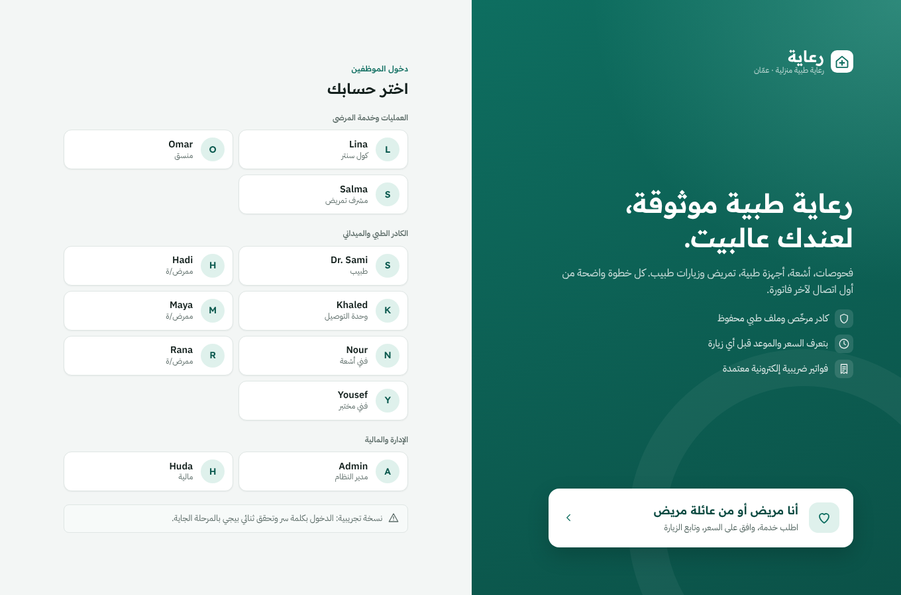

- **الموظفين:** بيختاروا حسابهم من القائمة.
  > بالنسخة التجريبية الدخول بدون كلمة سر. بالتشغيل الفعلي بيكون بكلمة سر لكل موظف.
- **المرضى:** كبسة **"أنا مريض أو من عائلة مريض"**، أو الرابط المباشر `/#patient`.

بعد الدخول، كل موظف بيشوف بس الشاشات اللي إلها علاقة بدوره، وبيطلع من زر **خروج** فوق.

---

## 3. تطبيق المريض

### 3.1 التسجيل والدخول
1. اكتب **الرقم الوطني** و**رقم الموبايل** واكبس **أرسل رمز التحقق**.
2. إذا هاي أول مرة، النظام بيطلب **الاسم الكامل** وبيفتحلك ملف.
3. بيوصلك **رمز من 6 أرقام** برسالة. اكتبه واكبس **دخول**.
   - الرمز صالح لمدة قصيرة، وبعد كم محاولة غلط بيتسكّر لحماية حسابك. اطلب رمز جديد.
   - إذا رقم الموبايل مش نفس الرقم المسجّل بملفك، اتصل بالشركة لتعديله.

### 3.2 طلب خدمة
1. تبويب **طلب خدمة**.
2. اختار الخدمة أو الخدمات (للأجهزة والتمريض بتحدد عدد الأيام أو الساعات).
3. اختار **الموعد اللي بناسبك**، وإذا مستعجل علّم **"بدي ياها بنفس اليوم"**.
4. إذا الخدمة بدها **وصفة طبيب** (مثل الأشعة أو الأكسجين) اكتب رقمها.
5. **أرسل الطلب**. ما في أي دفع قبل ما توافق على السعر.

### 3.3 متابعة الطلب
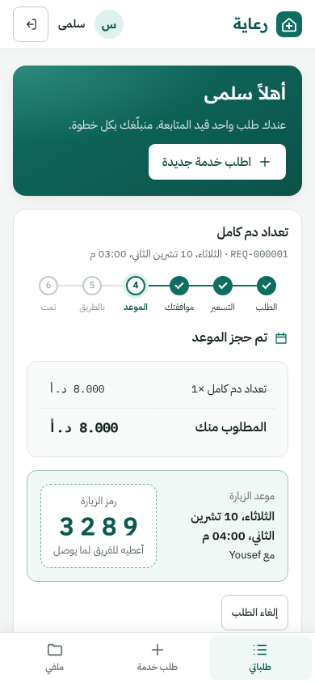

تبويب **طلباتي** بيعرض كل طلب مع شريط مراحل:
**الطلب ← التسعير ← موافقتك ← الموعد ← بالطريق ← تمت**

- **بدنا كم معلومة منك:** اكبس **أكمل ملفي** وعبّي الناقص.
- **السعر جاهز:** بتشوف البنود، وحصة التأمين إن وجدت، والمطلوب منك. اكبس **موافق** أو **مش موافق** (مع السبب).

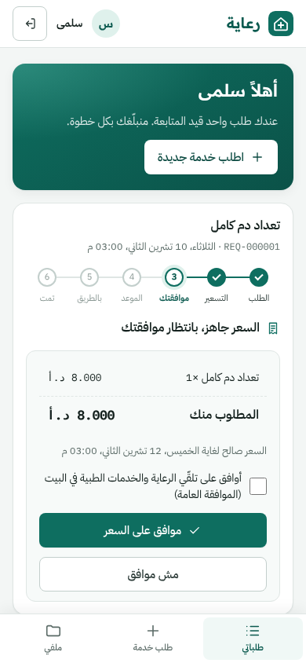

- **تم حجز الموعد:** بتشوف وقت الزيارة واسم الموظف، و**رمز الزيارة** (4 أرقام). **أعطِ الرمز للفريق لما يوصل**، فهيك بنتأكد إنه الزيارة صارت فعلاً.
- الصفحة بتتحدّث لحالها كل كم ثانية.
- **إلغاء الطلب:** ممكن قبل وصول الفريق. وإذا الموعد قريب ممكن تنطبق رسوم إلغاء حسب سياسة الشركة، والنظام بيبيّنها قبل ما تأكد.

### 3.4 ملفي
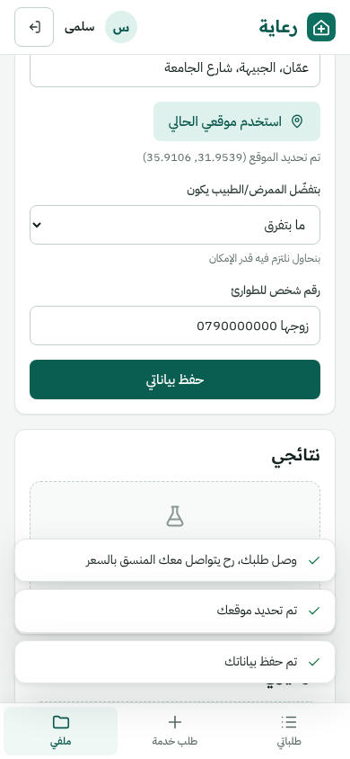

- **بياناتي:** تاريخ الميلاد، الجنس، العنوان بالتفصيل، **"استخدم موقعي الحالي"** (مهم كثير عشان يوصل الفريق)، رقم شخص للطوارئ، وإذا بتفضّل يكون الممرض أو الطبيب ذكر أو أنثى.
- **نتائجي:** النتائج بتظهر بعد ما يعتمدها المختص ويراجعها الطبيب.
- **فواتيري:** اكبس على أي فاتورة لتشوف **الفاتورة الضريبية** مع **رمز QR** من دائرة الضريبة.

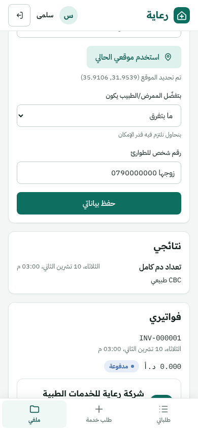

### 3.5 تقييم الخدمة
بعد ما تخلص الخدمة بيطلب منك التطبيق تقييم من 1 لـ 5 نجوم مع ملاحظة. التقييم المنخفض بيوصل للمشرف، ورح يتصل فيك.

---

## 4. الكول سنتر

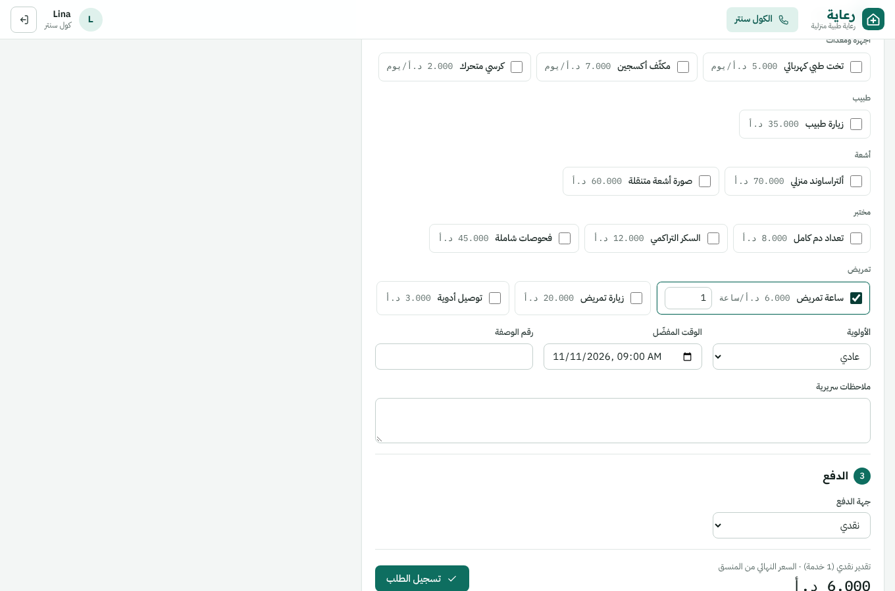

### 4.1 تسجيل طلب بالتلفون
1. **المريض:** اكتب الرقم الوطني واكبس **بحث**.
   - **ملف موجود:** البيانات بتنعبّى لحالها. راجعها مع المتصل.
   - **مريض جديد:** عبّي الاسم وتاريخ الميلاد والجنس والهاتف وجهة اتصال للطوارئ والعنوان، وإحداثيات الموقع (اطلب من المريض يبعتلك الموقع على الواتساب)، وتفضيل جنس الكادر إن وجد.
2. **الخدمة:** اختار الخدمات، والأولوية، والوقت المفضّل، ورقم الوصفة إذا مطلوبة، وملاحظات سريرية.
3. **الدفع:** نقدي، أو اختار شركة التأمين واكتب رقم العضوية.
4. **تسجيل الطلب.** التقدير اللي بيظهر بالأسفل نقدي تقريبي، والسعر النهائي من المنسق.

بعد التسجيل:
- **البيانات كاملة:** الطلب بيروح للمنسق مباشرة.
- **في نقص:** الطلب بيظهر بقائمة **"متابعة بيانات ناقصة"**.

### 4.2 متابعة البيانات الناقصة
بالقائمة على الجنب: اكبس **استكمال**، اتصل بالمريض، عبّي الناقص واكبس **حفظ**. الطلب بيرجع للمنسق تلقائياً.

---

## 5. المنسق

### 5.1 لوحة الطلبات
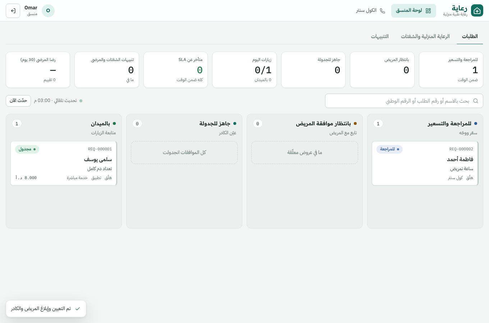

- **فوق:** مؤشرات اليوم: الطلبات بكل مرحلة، زيارات اليوم، **المتأخر عن الوقت المحدد (SLA)**، تنبيهات الشفتات والتصعيد، ورضا المرضى. اكبس على مؤشر المتأخر لتشوف الطلبات المتأخرة بس.
- **أعمدة اللوحة:**
  - **للمراجعة والتسعير:** طلبات جديدة لازم تتسعّر.
  - **بانتظار موافقة المريض:** عرض السعر انبعت.
  - **جاهز للجدولة:** المريض وافق، أو ما كان بالبيت (No-show) ولازم موعد جديد.
  - **بالميدان:** مجدول، بالطريق، أو قيد التنفيذ.
- البطاقة الحمرا عاجلة، والبرتقالية لنفس اليوم.
- البحث بالاسم أو رقم الطلب أو الرقم الوطني. اللوحة بتتحدّث لحالها كل 30 ثانية.

### 5.2 تسعير الطلب
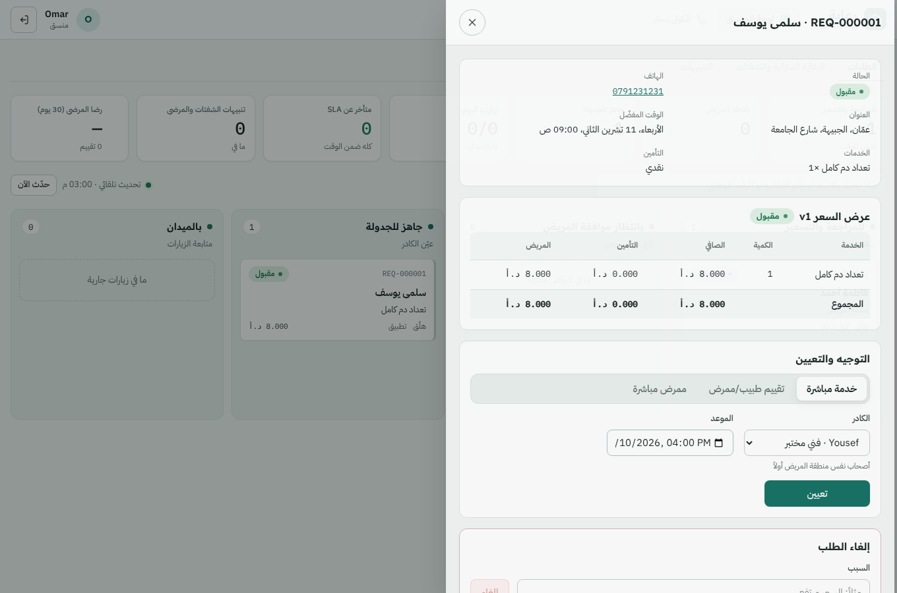

اكبس على البطاقة بتفتح نافذة الطلب:
1. **الخصم %:** فوق الحد المسموح (من الإعدادات، الافتراضي 10%) بدّه اختيار مشرف يوافق.
2. **رقم موافقة التأمين:** إذا الخدمة مؤمّنة وبتحتاج موافقة مسبقة، الطلب بيستنى لحد ما تدخل الرقم.
   - **إذا التأمين رفض:** اكبس **"التأمين رفض: سعّر نقدي"**. بيوصل للمريض عرض سعر نقدي، وهو بيقرر.
3. **موعد مبدئي:** بعد الدوام وأيام العطل السعر بيتضرب بمعامل بعد الدوام (من الإعدادات).
4. **احسب وأرسل العرض:** المريض بيوصله إشعار بالسعر.
   - العرض صالح لمدة محددة (48 ساعة، و4 ساعات للعاجل).
   - إذا انتهت صلاحيته، بتعيد التسعير.
5. إذا المريض وافق بالتلفون، اكبس **المريض وافق بالتلفون**.

### 5.3 التوجيه والتعيين
1. اختار المسار:
   - **خدمة مباشرة:** مختبر، أشعة، جهاز، أو زيارة طبيب.
   - **تقييم طبيب/ممرض:** للرعاية المنزلية.
   - **ممرض مباشرة.**
2. اختار **الكادر**. القائمة بتعرض بس المؤهلين للخدمة، وأصحاب **نفس منطقة المريض** أول.
3. حدد **الموعد** واكبس **تعيين**. المريض بيوصله اسم الموظف ورمز الزيارة، والموظف بيوصله إشعار.

**النظام بيمنع التعيين أو بينبّهك إذا:**
- الموظف مش من الدور المناسب، أو رخصته منتهية.
- عنده زيارة تانية بنفس الساعة.
- جنسه مختلف عن تفضيل المريض. حسب الإعدادات: إما تنبيه أو منع.
- المريض لازم يدفع مسبقاً، إما لأنه غاب أكثر من مرة، أو لأنه سياسة الدفع قبل الحجز مفعّلة. سجّل الدفعة المسبقة من نفس النافذة.

### 5.4 الإلغاء
من النافذة: اكتب السبب واكبس **إلغاء**.
- إذا الإلغاء **من طرف الشركة**، علّم الخيار وما في رسوم.
- إذا **من المريض**، النظام بيحسب رسوم الإلغاء حسب وقت الإلغاء قبل الموعد، وبيبيّنها قبل التأكيد.

### 5.5 الرعاية المنزلية والشفتات
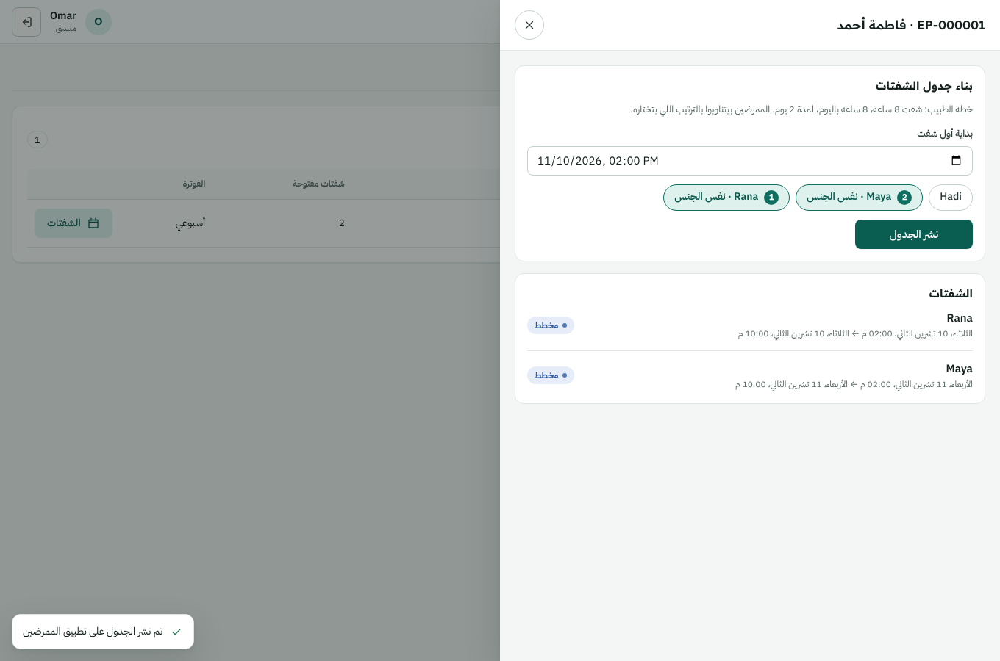

1. تبويب **الرعاية المنزلية والشفتات**: كل حالة نشطة مع خطة الطبيب وعدد الشفتات المفتوحة.
2. اكبس **الشفتات**، حدد **بداية أول شفت**، واختار الممرضين بالترتيب. الرقم على الاسم هو ترتيب التناوب.
3. **نشر الجدول:** الشفتات بتنبني حسب خطة الطبيب (8 أو 12 أو 24 ساعة)، وبتوصل على تطبيق الممرضين.

**النظام بيرفض الجدول إذا الممرض:**
- ما أخذ راحة كافية بين شفتين.
- رح يتجاوز أقصى ساعات بالأسبوع.
- عنده شفتات 24 ساعة ورا بعض أكثر من المسموح.

كل هالحدود من الإعدادات، والمشرف بيقدر يتجاوزها مع كتابة السبب.

- **تعليق الرعاية:** من نافذة الحالة اكتب السبب (مثلاً دخل المستشفى) واكبس **تعليق**.
  - الممرضين ما بيقدروا يسجّلوا حضور، وتنبيهات التأخير بتوقف.
  - الطبيب أو المشرف بيستأنف الرعاية لما يرجع المريض.

### 5.6 الأجهزة
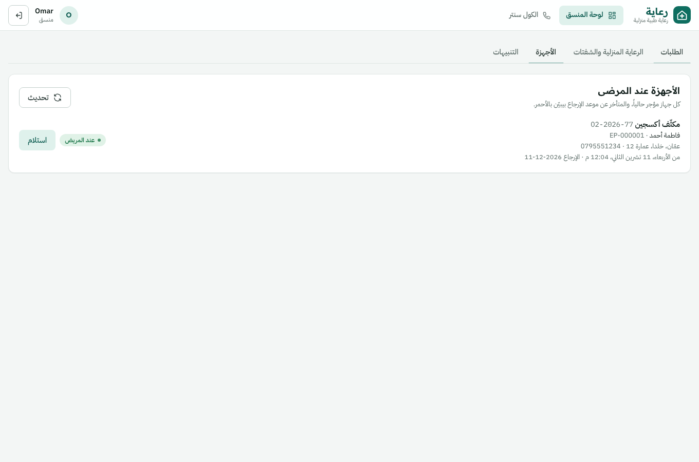

تبويب **الأجهزة** بيعرض كل جهاز مؤجر حالياً: المريض، الرقم التسلسلي، تاريخ البداية وموعد الإرجاع.
- **متأخر:** الجهاز اللي عدّى موعد إرجاعه بيطلع بالأحمر.
- **للاسترجاع:** الجهاز اللي صاحبه خلّص الرعاية بيطلع بالبرتقالي.
- **تمديد:** للأجهزة المؤجرة كخدمة مباشرة، بتحدد موعد إرجاع جديد، والمريض بيوصله إشعار.
- **استلام:**
  - **حالة الجهاز:** سليم، أو فيه ضرر (مع الكلفة والوصف).
  - **الإيجار المباشر:** إذا رجع الجهاز بعد الأيام المدفوعة، الأيام الزيادة والضرر بيطلعوا بفاتورة لحالها.
  - **الرعاية المنزلية:** أيام الإيجار بتنحسب بفاتورة الرعاية.
  - **التأمين النقدي:** إذا في تأمين بيرجع للمريض، المالية بيوصلها تنبيه.

### 5.7 التنبيهات
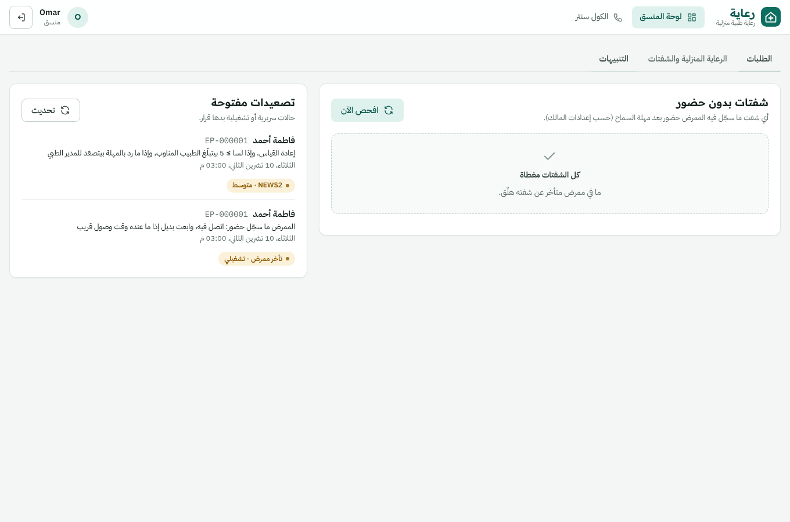

- **شفتات بدون حضور:** إذا الممرض ما سجّل حضور بعد مهلة السماح، الشفت بيظهر هون. اختار **ممرض بديل** واكبس **أرسل**.
- **تصعيدات مفتوحة:** قراءات NEWS2 عالية، نتائج حرجة، ممرض متأخر، حوادث. التصعيد السريري بيتعامل معه الطبيب، والمنسق بيتابع.

---

## 6. الكادر الميداني: المختبر، الأشعة، التوصيل

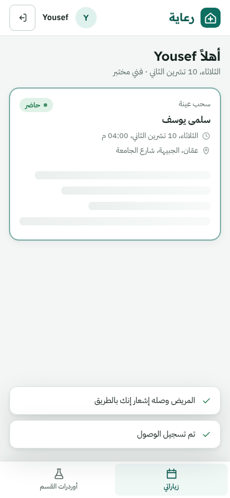

تطبيق الكادر مصمم للموبايل. تبويب **زياراتي** بيعرض زيارات اليوم:

1. **أنا بالطريق:** المريض بيوصله إشعار.
2. **وصلت · تسجيل الحضور:**
   - بالـ **GPS**، ولازم تكون قريب من عنوان المريض (المسافة من الإعدادات، الافتراضي 150 متر).
   - أو بـ **رمز الزيارة** اللي مع المريض.
   - إذا المريض ما وقّع **الموافقة على العلاج** قبل، علّم إنه المريض أو ولي الأمر وقّع على الجهاز. للأشعة في كمان موافقة خاصة. المريض تحت سن الرشد بيوقّع عنه ولي الأمر.
3. **المريض مش موجود:** بيتسجّل غياب (No-show)، والرسوم بتنحسب حسب السياسة، والمنسق بيتبلّغ ليعيد الجدولة.
4. **إنهاء الزيارة:**
   - **المختبر أو الأشعة:** اكتب النتيجة أو التقرير، وعلّم **نتيجة حرجة** إذا لزم، فبتتبلّغ للطبيب فوراً.
   - **الأجهزة:** الرقم التسلسلي، تاريخ الإرجاع، مبلغ التأمين، وتأكيد إنه العائلة تدرّبت ووقّعت نموذج الاستلام.
   - **الدفع:** النظام بيعرض المستحق على المريض. سجّل المبلغ المحصّل وطريقته (كاش، بطاقة، رابط، CliQ).
   - **حفظ وإنهاء:** الفاتورة بتصدر وبتنبعت لدائرة الضريبة تلقائياً (إذا الربط مفعّل).

**أوردرات القسم:** فنيو المختبر والأشعة والصيدلية والتوصيل بيشوفوا الأوردرات اللي طلبها الأطباء لمرضى الرعاية المنزلية، وكمان العينات والصور اللي انسحبت بزيارة خارجية وبعدها جاهزة للنتيجة.
1. اكبس **استلام**.
2. بعد التنفيذ اكتب النتيجة واكبس **اعتماد وإرسال**.

- **نتيجة الزيارة الخارجية:** بتوصل لملف المريض فوراً، إلا إذا كانت حرجة، فبتروح للطبيب المناوب.
- **توصيل جهاز** (وحدة التوصيل): اكتب **الرقم التسلسلي**. الإيجار بيبلّش من لحظة التسليم، وبينحسب على فاتورة الرعاية.

**فحص المخزون قبل الصرف** (إذا المالك شغّله):
- **قبل الصرف:** فوق زر **اعتماد وإرسال** بيبيّن صندوق المخزون: المادة، والكمية المطلوبة، والكمية الموجودة بمخزن الـ ERP.
  - **أخضر:** متوفر.
  - **أحمر:** مش متوفر، والصرف ممنوع أو مسموح مع تنبيه حسب إعدادات المالك.
- **الصيدلي:** بيقدر يفتح **"المواد اللي انصرفت فعلاً"** ويكتب المواد والكميات بالضبط.
- **بعد الصرف:** بتنسجّل حركة صرف بالـ ERP لحالها.

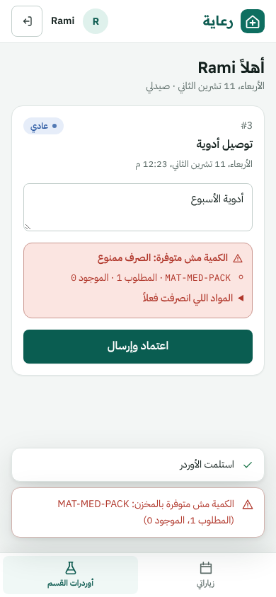

**استرجاع الأجهزة** (وحدة التوصيل): تبويب بيعرض الأجهزة اللي لازم ترجع، يعني انتهى موعدها أو صاحبها خلّص الرعاية. اكبس **استلام** ← حالة الجهاز ← **تأكيد الاستلام**.

---

## 7. الطبيب

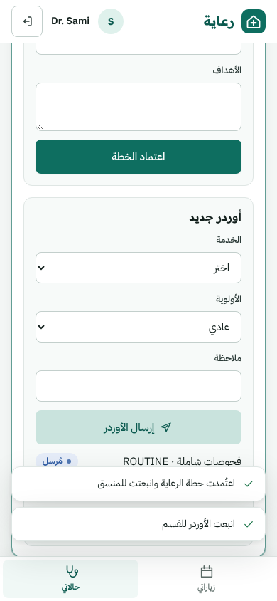

### 7.1 زيارة التقييم
من **زياراتي**: بالطريق ← وصلت ← **إنهاء الزيارة** ← نموذج التقييم:
- التشخيص، التاريخ المرضي، خطر السقوط (Morse)، قرح الفراش (Braden)، والحساسية.
- **مناسبة للرعاية المنزلية:** بينفتح ملف رعاية (Episode). اختار دورة الفوترة: أسبوعي أو شهري.
- **تحويل لمستشفى:** اكتب السبب، والطلب بيتسكّر.

### 7.2 حالاتي
لكل حالة نشطة:
- **التصعيدات:** قراءة NEWS2 أو تنبيه. اكتب **القرار** (تعديل علاج، زيارة، تحويل) واكبس **توثيق وإغلاق**. إذا ما رديت بالمهلة، التصعيد بيروح **للمدير الطبي**.
- **نتائج بانتظار مراجعتك:** اكبس **راجعت**، والنتيجة بتوصل للمريض. النتيجة الحرجة إذا ما انراجعت بالمهلة بتتصعّد للمدير الطبي.
- **خطة الرعاية:** طول الشفت، ساعات باليوم، المدة، والأهداف. **اعتماد الخطة** بيوصل للمنسق ليبني الجدول.
- **أوردر جديد:** مختبر، أشعة، صيدلية، أو أجهزة، بأولوية عادي أو عاجل أو فوري.
- **تعليق أو استئناف الرعاية:** اكتب ملاحظة واكبس **تعليق الرعاية** أو **استئناف الرعاية**.
  - قراءة NEWS2 بدرجة 7 أو أكثر بتعلّق الرعاية لحالها.
  - لما المريض يرجع للبيت ومستقر، الطبيب بيستأنفها.
- **إنهاء الرعاية:** اكتب ملخص الخروج.
  - الشفتات اللي بعد التاريخ بتتلغى.
  - الأجهزة بتظهر عند وحدة التوصيل للاسترجاع.

---

## 8. الممرض

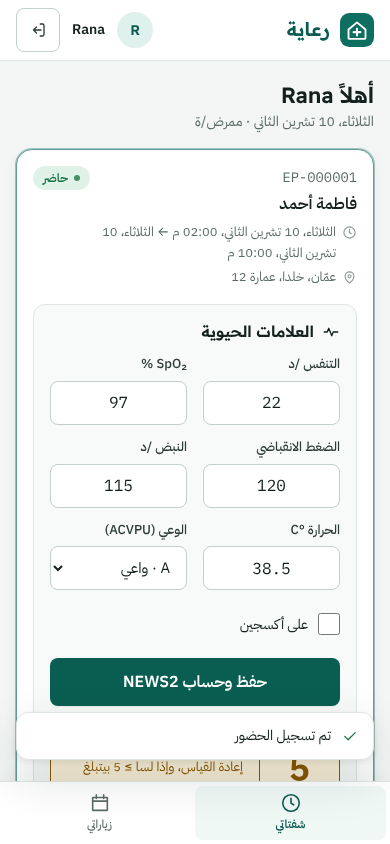

تبويب **شفتاتي**:
1. **تسجيل حضور الشفت:** بالموقع.
   - إذا تأخرت عن مهلة السماح، المنسق بيتبلّغ وممكن يبعت بديل.
2. **العلامات الحيوية:** التنفس، SpO₂، الضغط، النبض، الحرارة، الوعي (ACVPU)، وإذا المريض على أكسجين.
   - **حفظ وحساب NEWS2:** النتيجة بتطلع فوراً بلون حسب الخطورة:

   | النتيجة | المعنى |
   |---|---|
   | أخضر | متابعة روتينية |
   | أصفر | قراءة وحدة بدرجة 3 أو المجموع 5–6. أعد القياس، والطبيب المناوب بيتبلّغ |
   | أحمر | 7 أو أكثر: طوارئ. الطبيب والعائلة بيتبلّغوا والرعاية بتتعلّق |

3. **ملاحظات ومستجدات:** متابعة، أو أدوية، أو **حادثة**. الحادثة بتفتح مراجعة للمشرف.
4. **تسليم وإنهاء الشفت:** اكتب ملخص للممرض اللي بعدك، واكبس **Check-out**. الساعات الفعلية بتنحسب للفاتورة، ومقرّبة حسب الإعدادات.

---

## 9. المالية

### 9.1 الفواتير
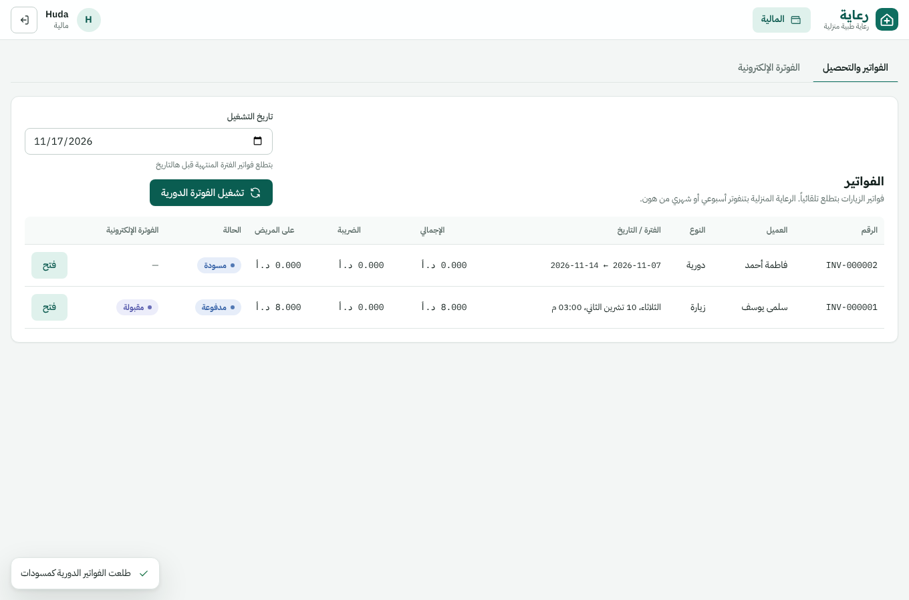

- **فواتير الزيارات المباشرة** بتصدر لحالها لما الموظف ينهي الزيارة.
- **الفوترة الدورية للتمريض:** اختار **تاريخ التشغيل** واكبس **تشغيل الفوترة الدورية**. بتطلع فواتير الأسبوع أو الشهر المنتهي كمسودات، وتشغيلها أكثر من مرة ما بيكرر الفواتير.
  - **بعد الفترة** (افتراضي): الفاتورة حسب الحضور الفعلي.
  - **مقدّماً** (من الإعدادات): الفاتورة حسب الجدول للفترة الجاية، والفرق مع الحضور الفعلي بيتسوّى بالفاتورة اللي بعدها.
- **فتح الفاتورة:**
  - **مطابقة مع الحضور وإصدار:** النظام بيرفض الإصدار إذا ساعات الفاتورة مش مطابقة لسجل الحضور.
  - **تسجيل دفعة:** الطريقة والمبلغ. الحالة بتصير مدفوعة جزئياً أو مدفوعة.
  - **الفاتورة الضريبية:** شكل الفاتورة الرسمي مع الضريبة والـ QR، وزر **طباعة**.

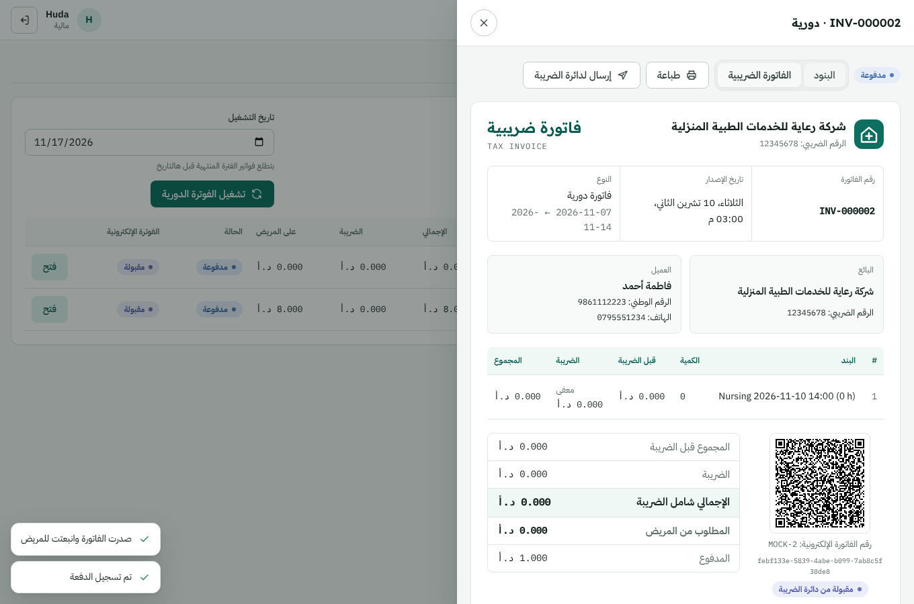

- **إلغاء فاتورة غلط:** من نافذة الفاتورة ← **إلغاء الفاتورة**، مع كتابة السبب.
  - **المسودة:** بتنلغى بس.
  - **الفاتورة الصادرة:** بيطلع **إشعار دائن** بنفس المبلغ بالسالب، وبينبعت لدائرة الضريبة مربوط بالفاتورة الأصلية.
  - **بعد الإلغاء:** البنود (شفتات، أوردرات) بترجع جاهزة للفوترة من جديد.
  - **الفاتورة المدفوعة:** ما بتنلغى قبل استرداد الدفعات.
- **فاتورة رعاية منزلية:** بتشمل الشفتات حسب الحضور، وأوردرات المختبر والأشعة والصيدلية اللي تنفّذت، وأيام إيجار الأجهزة.
  - **حصة التأمين:** بتنطبق بس على الخدمات اللي شركة التأمين بتغطيها.

### 9.2 مرضى مستمرين (فاتورة شهرية أو حسب الطلب)
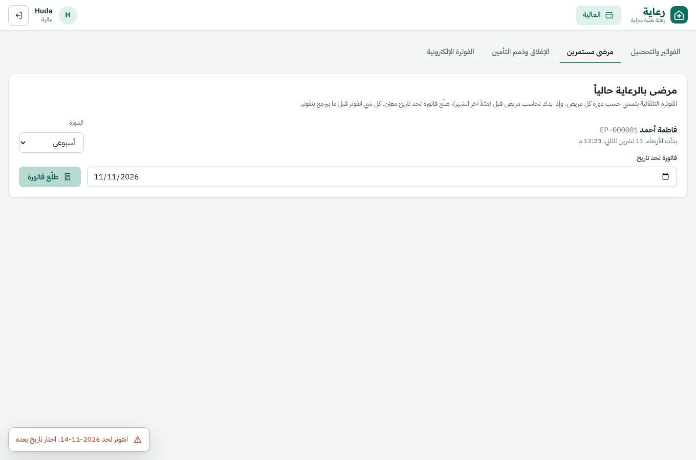

- **الدورة:** لكل مريض بالرعاية بتختار دورة الفوترة التلقائية، أسبوعي أو شهري.
- **طلّع فاتورة:** إذا بدك تحاسب مريض قبل ما يخلص علاجه (مثلاً آخر الشهر)، اختار **فاتورة لحد تاريخ** واكبس **طلّع فاتورة**.
  - الفاتورة بتشمل كل شي ما انفوتر لحد هالتاريخ: شفتات، أوردرات، وأيام أجهزة.
  - **ما في شي بيتفوتر مرتين:** الفاتورة الجاية، تلقائية أو يدوية، بتبلّش من حيث وقفت.
- **تشغيله وإطفاؤه:** المالك بيشغّل أو بيطفي هالخيار من **الإعدادات ← الدفع والفوترة**.

### 9.3 الإغلاق وذمم التأمين
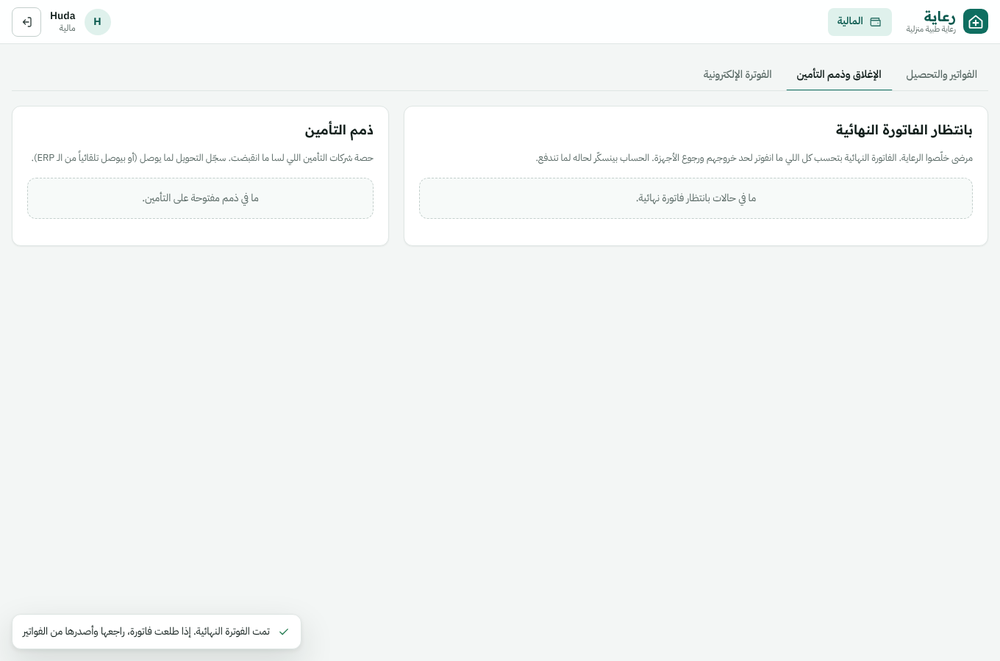

- **بانتظار الفاتورة النهائية:** المرضى اللي خلّصوا الرعاية. اكبس **الفاتورة النهائية**.
  - النظام بيرفض إذا لسا في جهاز عند المريض، فلازم وحدة التوصيل تسترجعه أول.
  - الفاتورة بتطلع مسودة. راجعها وأصدرها من تبويب الفواتير.
- **إغلاق الحساب:** لما كل فواتير الحالة تنصدر وتندفع، **الحساب بينسكّر لحاله**، والمريض بيوصله شكر وطلب تقييم، والـ ERP بيوصله إشعار.
- **ذمم التأمين:** كل فاتورة إلها حصة تأمين لسا ما انقبضت. سجّل التحويل لما يوصل، أو بيتسجّل تلقائياً إذا الـ ERP بعت الدفعة كدفعة تأمين.

### 9.4 الفوترة الإلكترونية (دائرة الضريبة)
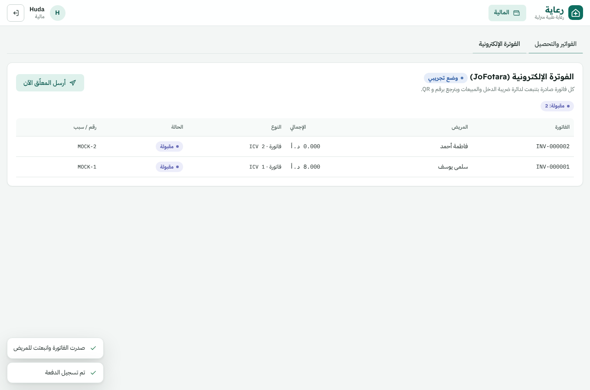

تبويب **الفوترة الإلكترونية (الضريبة)**:
- عدد الفواتير المقبولة والمرفوضة والمعلّقة، ونوع كل وحدة: فاتورة أو إشعار دائن.
- **مرفوضة:** السبب مكتوب من دائرة الضريبة. صحّح البيانات (مثلاً من الإعدادات أو ملف المريض) واكبس **إعادة إرسال**.
- **فشل:** إذا نظام الضريبة واقف، النظام بيعيد المحاولة لحاله على فترات.
- **فواتير صادرة وما انبعتت:** اكبس **إرسال** لكل وحدة.
- **ناقص بالإعدادات:** إذا الشاشة بتبيّن هاي الرسالة، المالك لازم يكمّل بيانات الشركة.

---

## 10. المالك: الإعدادات والربط مع الأنظمة

### 10.1 إعدادات المالك
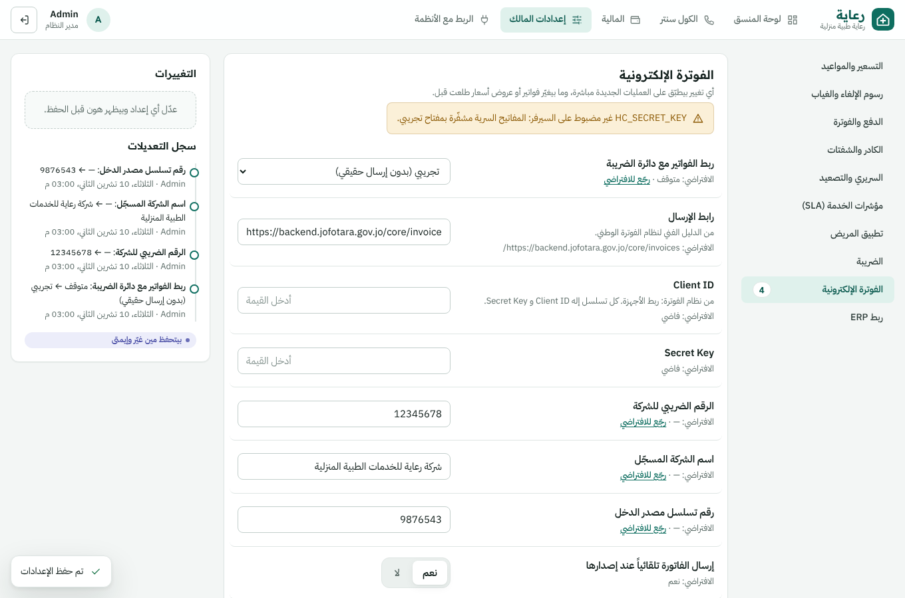

- **الشاشة:** الأقسام على اليمين. جنب كل إعداد بتشوف **القيمة الافتراضية**، وزر **رجّع للافتراضي** إذا عدّلتها.
- **الحفظ:** التعديلات بتظهر بخانة **التغييرات** قبل الحفظ.
- **السجل:** كل تغيير بينحفظ بـ **سجل التعديلات**: مين، وإيمتى، ومن شو لشو.
- **متى بيمشي التعديل:** على العمليات الجديدة فوراً، وما بيغيّر فواتير أو عروض أسعار طلعت قبل.

| القسم | أهم الإعدادات |
|---|---|
| التسعير والمواعيد | المنطقة الزمنية، معامل سعر بعد الدوام وساعاته، أيام وعطل رسمية بسعر بعد الدوام، أعلى خصم بدون مشرف، صلاحية عرض السعر |
| رسوم الإلغاء والغياب | الرسوم من حصة المريض أو السعر الكامل، حدود الإلغاء المجاني والرسوم الكاملة، نسبة الرسوم بينهم، رسوم No-show وحدها الأدنى وسقفها، الدفع المسبق بعد تكرار الغياب |
| الدفع والفوترة | الخدمات المباشرة: الدفع عند الباب أو قبل الحجز، فوترة التمريض: بعد الفترة أو مقدّماً، تقريب الساعات، التأخير المسموح |
| الكادر والشفتات | تطابق جنس الكادر (بدون، تنبيه، منع)، أقصى ساعات أسبوعياً، أقل راحة، شفتات 24 ساعة متتالية، مهلة الحضور، مسافة الـ GPS |
| السريري والتصعيد | المدير الطبي، الأطباء المناوبين، مهل التصعيد للنتيجة الحرجة وNEWS2، إعادة القياس، إرسال النتائج العادية بدون مراجعة، إلزامية الموافقة، عمر الرشد |
| مؤشرات الخدمة (SLA) | مهل المراجعة والتأمين وعرض السعر والتعيين اللي بتظهر بلوحة المنسق |
| تطبيق المريض | صلاحية رمز الدخول، عدد المحاولات، مدة الجلسة، إعدادات التقييم |
| الضريبة | الأسعار شاملة الضريبة، فئة ونسبة الضريبة لكل نوع خدمة (S خاضع، Z صفر، O معفى) |
| الفوترة الإلكترونية | الربط (متوقف، تجريبي، JoFotara)، رابط الإرسال، Client ID و Secret Key، الرقم الضريبي، اسم الشركة، تسلسل مصدر الدخل، الإرسال التلقائي، نوع الفاتورة (نقدي، ذمم) |
| ربط ERP | رابط الـ Webhook ومفتاح التوقيع، حساب الإيراد لكل نوع خدمة، رمز الضريبة بالـ ERP، مركز الكلفة |
| المخزون (ERP) | فحص المخزون (متوقف، تجريبي، ERP عام، SAP)، المنع أو التنبيه إذا الكمية مش كافية، التصرف إذا الـ ERP ما رد، الرابط والدخول، Plant و Storage Location و Movement Type، رقم المادة لكل خدمة |

> **المفاتيح السرية** (Client ID، Secret Key، مفتاح الـ Webhook) بتنحفظ مشفّرة وما بتنعرض مرة تانية. لتغيير أي وحدة منها، اكتب القيمة الجديدة واحفظ.

### 10.2 ربط الفوترة مع دائرة الضريبة: خطوات البداية
1. من بوابة نظام الفوترة الوطني (JoFotara): **ربط الأجهزة**، وخذ **Client ID** و**Secret Key** لتسلسل مصدر الدخل.
2. بالإعدادات ← **الفوترة الإلكترونية**: عبّي الرقم الضريبي، واسم الشركة، وتسلسل مصدر الدخل، والمفاتيح.
3. جرّب أول على **تجريبي**، وتأكد إنه الفاتورة بتطلع صحيحة مع QR.
4. حوّل لـ **JoFotara**، وابعت فاتورة حقيقية وحدة، وراجعها مع المحاسب.
5. راجع **الضريبة** لكل نوع خدمة مع المحاسب الضريبي.

### 10.3 الربط مع الأنظمة (ERP مثل SAP)
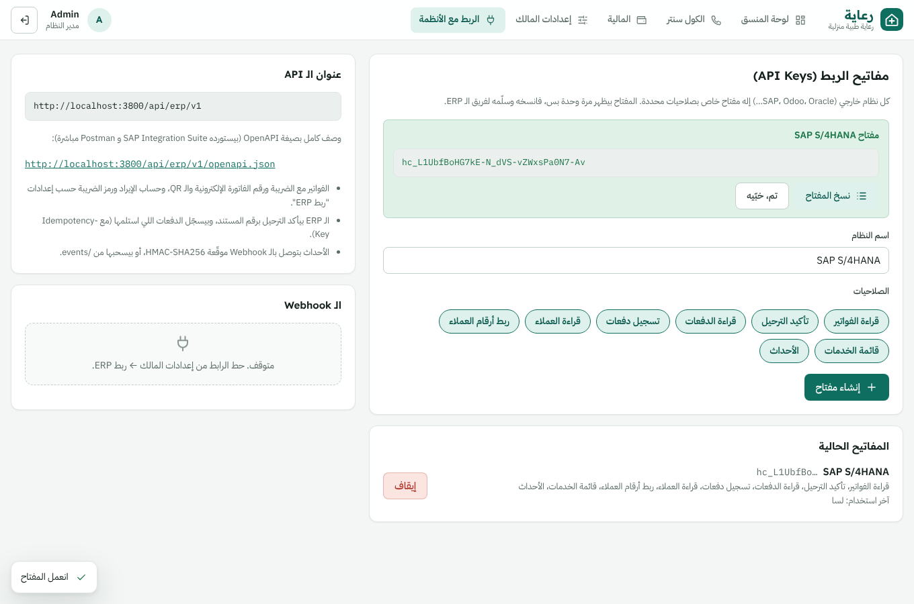

1. **إنشاء مفتاح:** اسم النظام (مثلاً SAP S/4HANA) والصلاحيات.
   - **المفتاح بيظهر مرة وحدة بس.** انسخه وسلّمه لفريق الـ ERP.
2. سلّمهم كمان **عنوان الـ API** ورابط الوصف (OpenAPI).
3. **الإيقاف:** بأي وقت **إيقاف** المفتاح بيقطع الوصول فوراً.
4. **الـ Webhook:** بيبيّن كم حدث انبعت، وكم فشل وليش.
5. **صرف المخزون (ERP):** كل حركة صرف وحالتها، ورقم المستند بالـ ERP، وزر **أرسل المعلّق الآن**. بالوضع التجريبي في **مخزن تجريبي** بتقدر تعدّل كمياته لتجرّب حالة النقص.

التفاصيل التقنية لفريق الـ ERP بملف `docs/erp-and-tax-integration.md`.

---

## 11. مراحل الطلب وحالاته

| الحالة | المعنى | مين بيتصرف |
|---|---|---|
| بيانات ناقصة | معلومات إلزامية ناقصة | الكول سنتر أو المريض |
| للمراجعة | بانتظار التسعير | المنسق |
| بانتظار التأمين | بانتظار الموافقة المسبقة | المنسق |
| عرض سعر مُرسل | بانتظار موافقة المريض | المريض أو الكول سنتر |
| منتهي الصلاحية | عرض السعر انتهى | المنسق يعيد التسعير |
| مقبول | المريض وافق | المنسق يعيّن |
| مجدول | في موعد وموظف | الموظف |
| بالطريق | الموظف طلع | الموظف |
| قيد التنفيذ | الموظف سجّل وصوله | الموظف |
| No-show | المريض ما كان بالبيت | المنسق يعيد الجدولة |
| مكتمل | الخدمة خلصت | — |
| رعاية منزلية | انفتح ملف رعاية | الطبيب والمنسق |
| محوّل | تحوّل لمستشفى | — |
| ملغي | انلغى مع السبب | — |

---

## 12. أسئلة شائعة وحل المشاكل

| المشكلة | الحل |
|---|---|
| ما بقدر أسجّل وصول: "أنت بعيد عن عنوان المريض" | تأكد إنه الـ GPS شغّال بالموبايل، أو استعمل رمز الزيارة من المريض. إذا عنوان المريض غلط، المنسق بيعدّله |
| "Consent missing" أو ما بقدر أبلّش الزيارة | علّم إنه المريض أو ولي الأمر وقّع الموافقة على الجهاز |
| التعيين انرفض: "Staff licence expired" | رخصة الموظف منتهية. المالك أو الموارد البشرية بيحدّثوها |
| التعيين انرفض بسبب دفعة مسبقة | سجّل الدفعة المسبقة من نافذة الطلب بعدين عيّن |
| الجدول انرفض بسبب ساعات العمل | غيّر الممرضين أو التوقيت. المشرف بيقدر يتجاوز مع سبب |
| الفاتورة ما انصدرت: "Invoice hours do not match attendance" | في فرق بين الفاتورة والحضور. راجع الشفتات |
| الفاتورة مرفوضة من الضريبة | اقرأ السبب بتبويب الفوترة الإلكترونية، صحّح، وأعد الإرسال |
| المريض ما وصله رمز الدخول | تأكد من رقم الموبايل بملفه. بالنسخة التجريبية الرمز بيظهر عالشاشة |
| بدي أغيّر نسبة أو مهلة | المالك من **إعدادات المالك**، وما في حاجة لمبرمج |
| "Care is on hold" عند تسجيل حضور الشفت | الرعاية معلّقة. لازم الطبيب أو المشرف يستأنفها |
| "Collect the devices first" عند الفاتورة النهائية | في جهاز لسا عند المريض. وحدة التوصيل لازم تسجّل استلامه |
| ما بقدر ألغي فاتورة مدفوعة | لازم الدفعات تنسترد أول |
| "الكمية مش متوفرة بالمخزن" عند الصرف | المادة مش موجودة بمخزن الـ ERP. اطلبها من المستودع، أو المالك بيغيّر السياسة لـ "اسمح ونبّه" |
| "انفوتر لحد…" عند الفاتورة المرحلية | الفترة مفوترة من قبل. اختار تاريخ بعدها |

---

## 13. للفريق التقني

**التشغيل:**
- **أسرع طريقة:** GitHub Codespaces، أو `./start.sh` (لينكس وماك)، أو `start.bat` (ويندوز). بعدها افتح `http://localhost:3000`.
- **المتطلبات:** Node.js 22.

**الاختبارات:**
- `cd backend && npm test`: 137 اختبار، منها 6 دورات عمل كاملة.
- `./e2e/run.sh`: اختبار من المتصفح لكل الأدوار، 20 خطوة لحد إغلاق الحساب، ومعها فحص المخزون والفاتورة المرحلية. التقرير بـ `docs/qa-report.md`.

**الوثائق:**

| الملف | المحتوى |
|---|---|
| `README.md` | التشغيل والبنية |
| `docs/business-requirements.md` | متطلبات العمل والقواعد |
| `docs/workflow-bpmn.html` | مخطط العملية BPMN |
| `docs/erp-and-tax-integration.md` | الضريبة، JoFotara، والـ ERP API |
| `docs/qa-report.md` | تقرير الفحص |
| `docs/ba-gap-analysis.md`، `docs/product-backlog.md` | تحليل الفجوات وقائمة المنتج |

**قبل التشغيل الفعلي:**
1. دخول الموظفين بكلمة سر.
2. ربط خدمة SMS.
3. ضبط `HC_SECRET_KEY` على السيرفر.
4. النقل لـ PostgreSQL مع نسخ احتياطي.
5. تجربة أول فاتورة حقيقية مع JoFotara.
